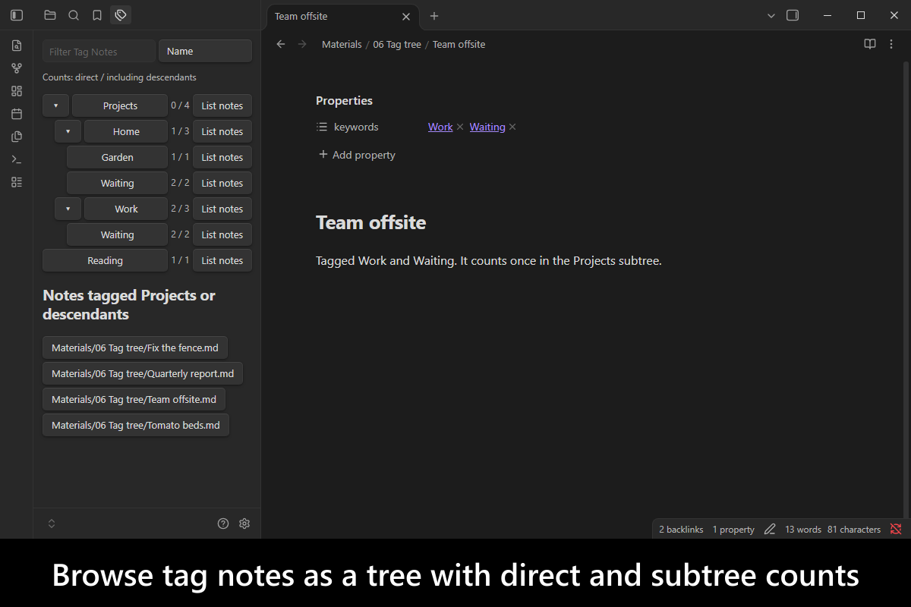
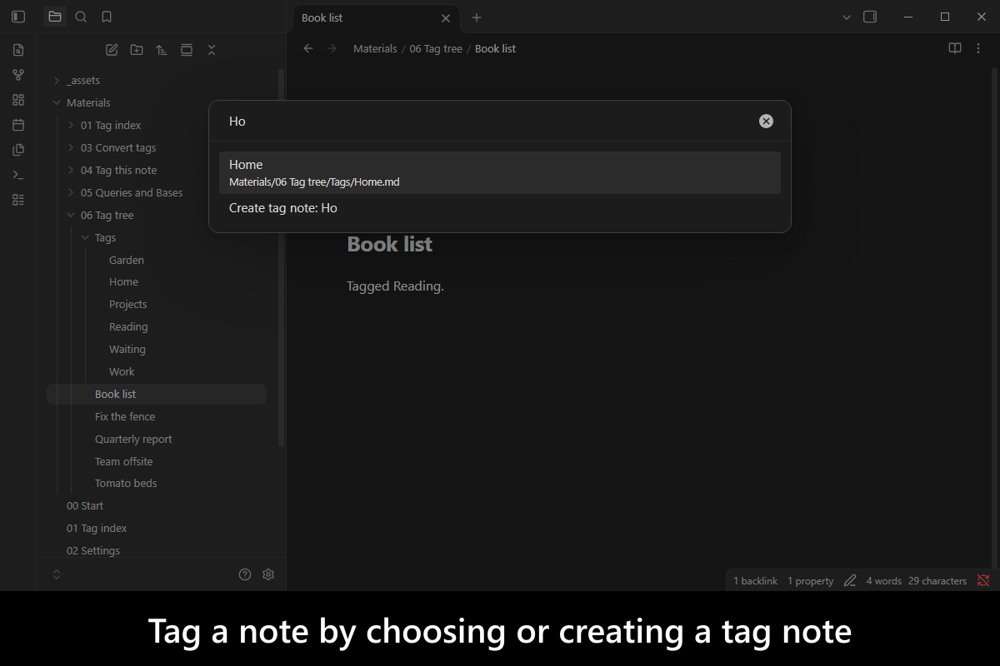
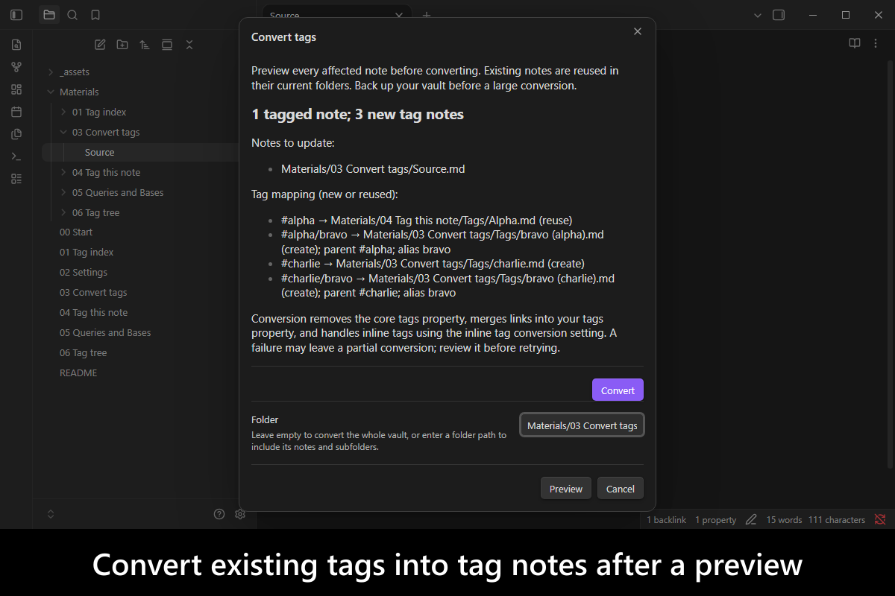
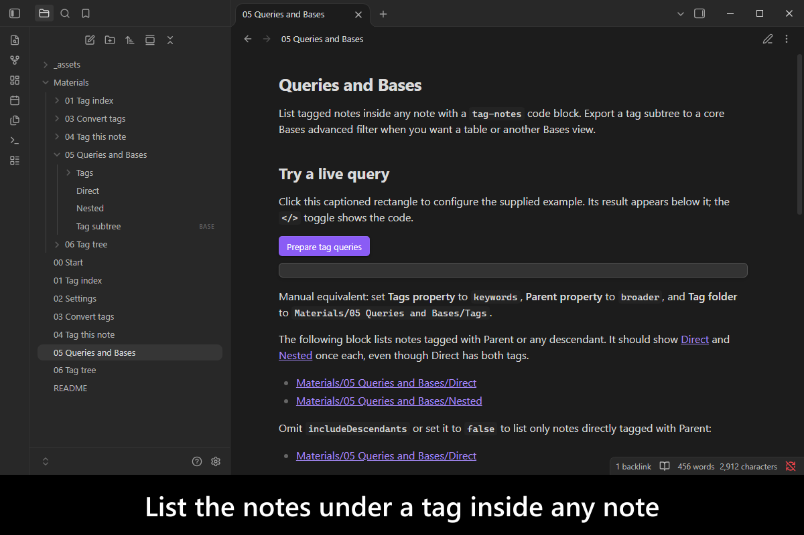
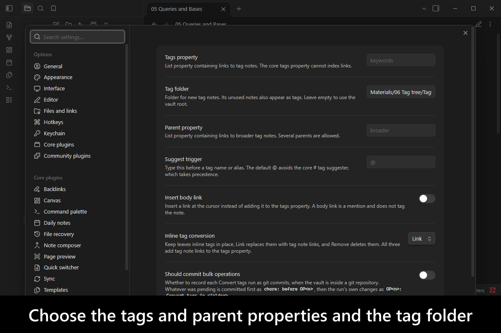
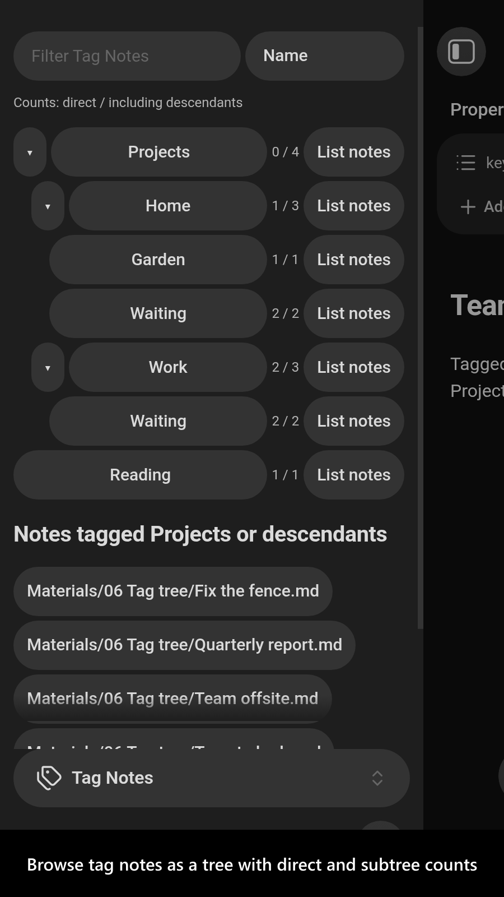
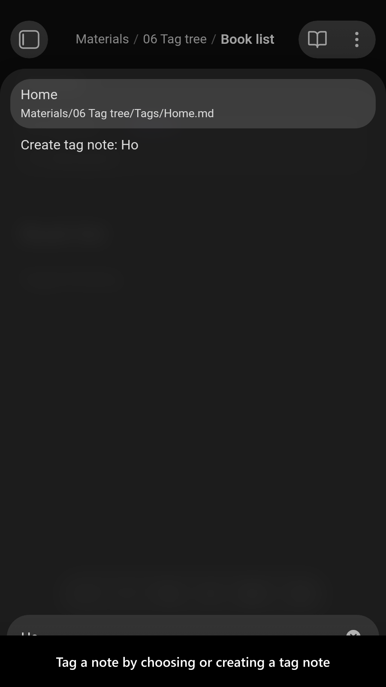
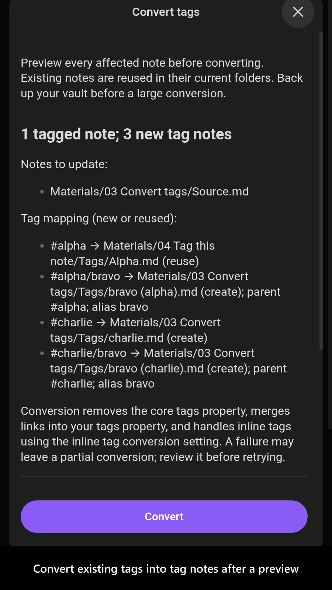
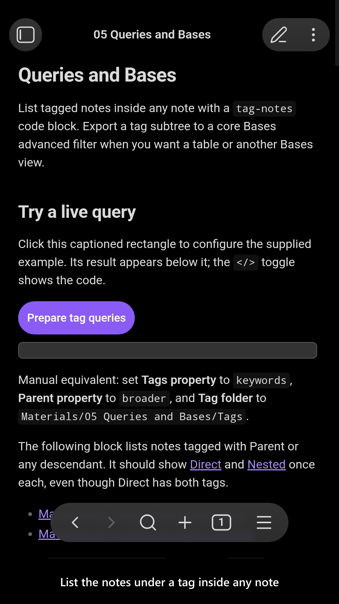
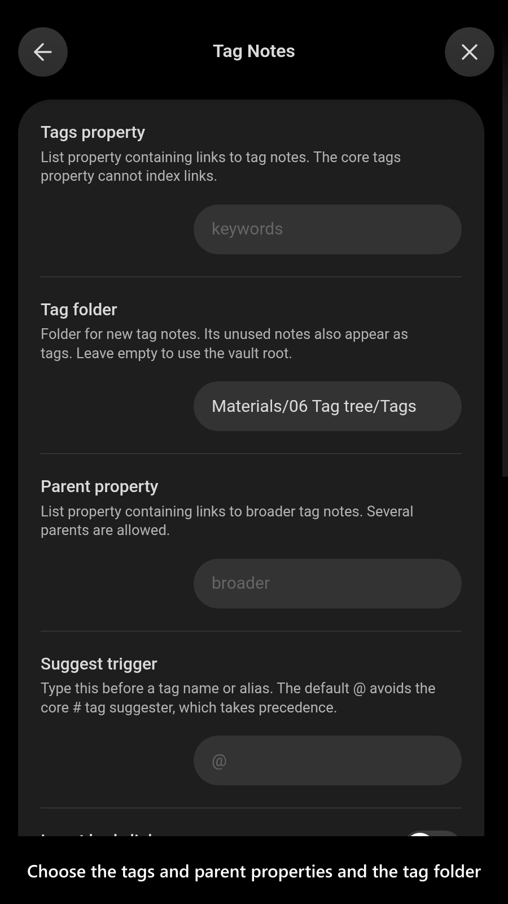

# Tag Notes

[](https://www.buymeacoffee.com/mnaoumov) [](https://github.com/mnaoumov/obsidian-tag-notes/releases) [](https://github.com/mnaoumov/obsidian-tag-notes/releases) [](https://github.com/mnaoumov/obsidian-tag-notes)

A `#tag` is a bare string. It cannot carry a description, aliases or properties of its own, a misspelt one silently becomes a new tag, and renaming one is a search-and-replace across the vault. A note has none of those problems, but tagging with links to notes loses what `#tags` give you: `#parent/child` hierarchy, the Tags pane with its tree and counts, and suggestions as you type.

`Tag Notes` makes the note the tag, so your tag pages are the tags themselves. A note is tagged by linking tag notes from a list property, `keywords` by default; a tag note names its parents in `broader`. The plugin brings back the hierarchy, a tag tree with counts, "tagged X or anything under X" lists, an `@` suggester, and a previewed conversion of your existing `#tags`. All of it is plain frontmatter links, so the data stays readable with no plugin installed, and renaming a tag note renames the tag everywhere.

<!-- markdownlint-disable MD033 -->

<a href="https://github.com/mnaoumov/obsidian-tag-notes/blob/HEAD/images/screenshots/screenshot-desktop-1.png"></a>

<details>
<summary>More screenshots</summary>

<div>
<a href="https://github.com/mnaoumov/obsidian-tag-notes/blob/HEAD/images/screenshots/screenshot-desktop-2.png"></a>
<a href="https://github.com/mnaoumov/obsidian-tag-notes/blob/HEAD/images/screenshots/screenshot-desktop-3.png"></a>
<a href="https://github.com/mnaoumov/obsidian-tag-notes/blob/HEAD/images/screenshots/screenshot-desktop-4.png"></a>
<a href="https://github.com/mnaoumov/obsidian-tag-notes/blob/HEAD/images/screenshots/screenshot-desktop-5.png"></a>
<a href="https://github.com/mnaoumov/obsidian-tag-notes/blob/HEAD/images/screenshots/screenshot-mobile-1.png"></a>
<a href="https://github.com/mnaoumov/obsidian-tag-notes/blob/HEAD/images/screenshots/screenshot-mobile-2.png"></a>
<a href="https://github.com/mnaoumov/obsidian-tag-notes/blob/HEAD/images/screenshots/screenshot-mobile-3.png"></a>
<a href="https://github.com/mnaoumov/obsidian-tag-notes/blob/HEAD/images/screenshots/screenshot-mobile-4.png"></a>
<a href="https://github.com/mnaoumov/obsidian-tag-notes/blob/HEAD/images/screenshots/screenshot-mobile-5.png"></a>
</div>

</details>

<!-- markdownlint-enable MD033 -->

## Demo vault

**The documentation is an interactive demo vault.** Every feature has a note that explains what it does and why you would want it, with a button that prepares a supplied set of tag notes so you can try each command on them at once.

**[Start reading here](<./demo-vault/00 Start.md>)** — it is plain markdown, so it works on GitHub with nothing installed.

A copy of the vault ships with every release. You can access it via any of the following:

1. Running the **`Tag Notes`: Open demo vault** command.
2. Downloading `tag-notes-demo-vault.zip` from the [Releases](https://github.com/mnaoumov/obsidian-tag-notes/releases). It unzips into a single `tag-notes-demo-vault-<version>` folder.
3. Browsing its source in [`demo-vault/`](./demo-vault/README.md) in this repository.

## What it does

- **Tag notes and their hierarchy**: a note's tags are the links in its `keywords` list, a tag note lists its parents in `broader`, several parents are allowed, and a cycle is reported and broken without editing any note. Every tag has a direct count and a count with descendants, each note counted once: see [Tag index](<./demo-vault/01 Tag index.md>).
- **Tag tree**: a sidebar view like the core Tags pane, with both counts, a filter, sorting by name or count, the notes of a subtree, and rename, new child tag and reveal on a right-click: see [Tag tree](<./demo-vault/06 Tag tree.md>).
- **Tag this note** and the `@` suggester: choose a tag note by name or alias, or create one, and the link lands in the tags property: see [Tag this note](<./demo-vault/04 Tag this note.md>).
- **Convert tags**: turn the `#tags` of the whole vault or one folder into tag notes, `#a/b` into `b` with `broader: [[a]]`, after a preview of every note it will change. In a vault kept in git, each run can be one commit that **Undo a bulk operation...** reverts: see [Convert tags](<./demo-vault/03 Convert tags.md>) and [undo with git](<./demo-vault/02 Settings.md#undo-with-git>).
- **Queries and Bases**: a `tag-notes` code block lists the notes tagged with a tag, with or without its descendants, and **Copy Bases filter for tag subtree** exports a subtree as a core Bases filter: see [Queries and Bases](<./demo-vault/05 Queries and Bases.md>).

Every setting is listed by its `data.json` key in [Settings](<./demo-vault/02 Settings.md>).

## See also

[My other Obsidian resources](https://mnaoumov.dev/obsidian/)

| Plugin | Features | How `Tag Notes` differs |
| --- | --- | --- |
| [`Breadcrumbs`](https://community.obsidian.md/plugins/breadcrumbs) | hierarchies from typed links such as `up` and `down`; implied and transitive relations; trail, matrix and tree views | Overlaps on hierarchy: not about tags, so no tag counts, no "tagged X or below" list and no conversion of `#tags`; works beside it, with `broader` declared as an `up` field |
| [`Index Notes`](https://community.obsidian.md/plugins/index-notes) | generates index blocks from hierarchical `#tags` | Same goal of listing notes by tag: the tag is a note rather than a `#tag` |
| [`Notebook Navigator`](https://community.obsidian.md/plugins/notebook-navigator) | a file browser with a `#tag` tree among its navigation | Covers part of it: browses `#tag` hierarchies; tag notes are not tags there |
| [`Tag Along`](https://community.obsidian.md/plugins/tag-along) | browses the vault as a folder tree built from `#tags` | Covers part of it: the tree is of `#tags`, not of tag notes |
| [`Tag Folder Explorer`](https://community.obsidian.md/plugins/tag-folder-explorer) | virtual folders from nested `#tags` | Covers part of it: the tree is of `#tags`, not of tag notes |
| [`Tag Ontology`](https://community.obsidian.md/plugins/tag-ontology) | parents, children and related tags for `#tags`, kept in a JSON dictionary; roll-up counts; Graph view | Same goal of a tag hierarchy: the hierarchy lives in the tag notes' own `broader` links, not in a plugin file; `#tags` are converted rather than kept as the source of truth |
| [`Tag Page`](https://community.obsidian.md/plugins/tag-page-md) | generates and updates a page listing each `#tag`'s references | Inverse direction: the page is generated from the `#tag`; here the note is the tag |
| [`Tag Wrangler`](https://community.obsidian.md/plugins/tag-wrangler) | renames, merges and searches `#tags` from the Tags pane; tag pages, notes carrying a `#tag` alias | Inverse direction: its tag page describes a `#tag` that stays the source of truth; here the note is the tag, and renaming it is a file rename |
| [`TagFolder`](https://community.obsidian.md/plugins/obsidian-tagfolder) | shows `#tags` as folders | Covers part of it: the tree is of `#tags`, not of tag notes |
| [`Unified Tag Links`](https://community.obsidian.md/plugins/unified-tag-links) | links `#tags` to concept notes that list the tag in their aliases, through a managed `tag_links` property | Same goal of joining notes and tags: keeps the `#tag` as the source and derives the links; here the links are the tags, with a tree, counts and a one-shot conversion |

Last searched for similar plugins on 2026-11-01.

## For plugin developers

This plugin publishes a read-only API, declared in [api.d.ts](./api.d.ts), for plugins and scripts that want to know whether a file is a tag note, a note's tags, the notes tagged with a tag with or without its descendants, a tag's parents, children, ancestors and descendants, and its counts.

```ts
import { watchPluginApi } from '@mnaoumov/obsidian-lib/plugin/plugin-api';

import type { TagNotesApi } from './api.d.ts';

const apiRef = watchPluginApi<TagNotesApi>({
  apiVersionRange: '^1.0.0',
  app: this.app,
  component: this,
  pluginId: 'tag-notes'
});

// `value` is always current: `null` while this plugin is not loaded, and non-`null` on its own once it is.
const api = apiRef.value;
if (api) {
  console.log(api.getCounts(tag)); // { direct: 1, withDescendants: 3 }
}
```

The handle comes from the `@mnaoumov/obsidian-lib` plugin registry; [Cross-plugin APIs](https://mnaoumov.dev/obsidian-lib/guides/cross-plugin-apis/) covers `watchPluginApi` and the registry from the library's side. The contract version is `1.0.0`, and it moves independently of the plugin's own version, so ask for a range.

If you would rather not depend on `@mnaoumov/obsidian-lib` for the handle, the registry is a documented wire protocol you can read directly — see [Plugin API protocol](https://mnaoumov.dev/obsidian-lib/guides/plugin-api-protocol/).

## Installation

The plugin is not yet listed in [the official Community Plugins repository](https://community.obsidian.md/plugins). Until it is, install it as a beta release.

### Beta versions

To install the latest beta release of this plugin (regardless if it is available in [the official Community Plugins repository](https://community.obsidian.md) or not), follow these steps:

1. Ensure you have the [BRAT plugin](https://community.obsidian.md/plugins/obsidian42-brat) installed and enabled.
2. Click [Install via BRAT](https://intradeus.github.io/http-protocol-redirector?r=obsidian://brat?plugin=https://github.com/mnaoumov/obsidian-tag-notes).
3. An Obsidian pop-up window should appear. In the window, click the `Add plugin` button once and wait a few seconds for the plugin to install.

## Debugging

By default, debug messages for this plugin (id: `tag-notes`) are hidden.

If you need to enable them refer to the [documentation](https://mnaoumov.dev/obsidian-lib/guides/debugging/).

## Contributing

Contributions are welcome — see [CONTRIBUTING](./CONTRIBUTING.md) to get set up.

## Support

<!-- markdownlint-disable MD033 -->

<a href="https://www.buymeacoffee.com/mnaoumov" target="_blank"></a>

<!-- markdownlint-enable MD033 -->

### Filing an issue (for AI agents and humans)

Open issues through the [issue forms](https://github.com/mnaoumov/obsidian-tag-notes/issues/new/choose), not as blank issues.

To report a bug from inside Obsidian, run the **`Tag Notes`: Report a bug** command. It opens the bug form with the plugin version, the Obsidian version and your operating system already filled in.

Filing from the CLI or the API (`gh issue create --body`, or an AI agent filing for you) skips the form, and `gh issue create --template` cannot load an issue form. In that case, open the matching form in [`.github/ISSUE_TEMPLATE/`](https://github.com/mnaoumov/obsidian-tag-notes/tree/HEAD/.github/ISSUE_TEMPLATE), copy every field as a `### <label>` heading in the form's order, and fill in each one. Always state the plugin version, the Obsidian version and your operating system.

## License

© [Michael Naumov](https://github.com/mnaoumov/)
